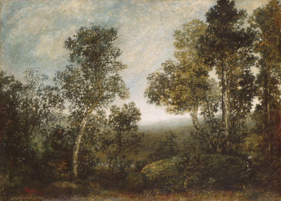
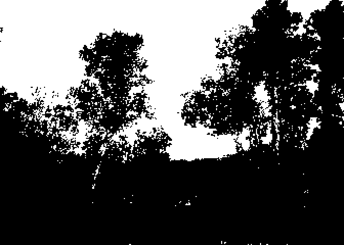
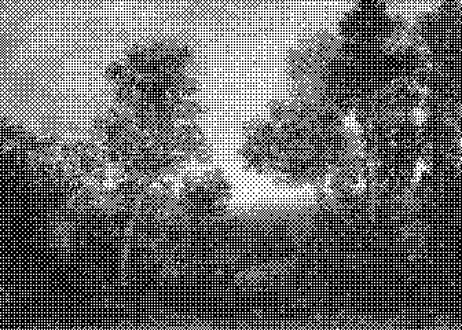
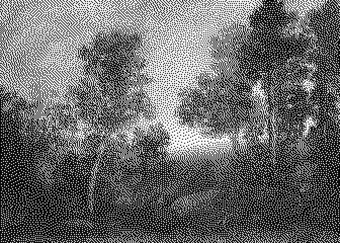

# Halftone

A full-screen terminal desk for your Claude Code and Codex sessions, stocks, mail and other feeds, with a built-in image renderer that draws BMP and PPM files as half blocks, quadrants, braille or ASCII.

## Demo

The same photo (Met Museum landscape, CC0) as source, then as a braille grid at 200x60 terminal cells (400x240 dots, shown at 2x) with no dither, Bayer and Floyd-Steinberg.

| Source | none | Bayer (default) | Floyd-Steinberg |
|---|---|---|---|
|  |  |  |  |

The grids come from `halftone::image::draw`, the same call the desk uses, dumped by `benches/image.rs`.

## Quickstart

### Install

```bash
git clone https://github.com/A-G0D/halftone.git
cd halftone
./install.sh
```

That builds it (it offers to install Rust if you don't have it), puts `halftone` on your PATH and
opens it. The first time, it walks you through linking your apps; press Enter to skip any of them.

After a `git pull`, run `./install.sh` again.

### Use

```bash
halftone                # open the desk
halftone setup          # link everything again
halftone setup discord  # or one step: stocks discord gmail stripe x path layout
halftone config         # the desk file, which the desk reloads on save
```

- **Discord** and **Mail** need no keys: halftone reads the badge on their Dock icons (macOS).
  For Discord unreads, turn on Discord › Settings › Notifications › Enable Unread Message Badge.
- **Gmail** works through Apple Mail (add Google under System Settings › Internet Accounts) or an
  app password.
- **Stripe** needs a restricted key that can only read invoices; **X** needs your own X developer app.
- Keys and passwords are stored in their own files, readable only by you, next to the desk file
  in `~/.config/halftone/`.

Best in Ghostty, kitty or WezTerm, full screen (it needs at least 70×20).

### Benchmark

Run the image benchmark (needs Rust, Python 3 with Pillow and numpy, and macOS `sips` for the BMP conversion):

```bash
bench/run.sh      # fetches 3 CC0 images, times decode and draw, scores quality, writes bench/results.txt
cargo test --release --locked
```

## How it works

`src/image.rs` decodes 24 and 32 bit BMP and binary PPM, box-filters the image down to the cell grid, then quantizes each cell to the chosen mode: half blocks, quadrants, braille dots, shaded blocks or ASCII. Dither is none, a 4x4 Bayer matrix (default) or Floyd-Steinberg. The rest of the program is the desk: 41 shell modules under `modules/` that feed panels. `benches/image.rs` is a plain `std::time` binary with no criterion. It calls `Image::decode` and `image::draw` on every image in `bench/images/` at a 200x60 terminal and reports the median of at least 7 runs over at least 0.5 s.

## Results

Machine: Apple M5 Pro, macOS, run under background QoS (`taskpolicy -b`). Three CC0 photos from Wikimedia Commons, fetched by `bench/fetch.sh` and kept out of git: Landscape MET ap29.35 (1920x1371), Landscape Painting 01 (1280x1920), Landscape South of Urbino (3840x2439). Throughput is source megapixels per second through the real entry points.

| Metric | Ours | Market standard | Goal |
|---|---|---|---|
| Braille Bayer draw, Mpix/s (met / portrait / urbino) | 172 / 343 / 366 | numpy Bayer 4x4 on the same job: 34 / 30 / 24 (reimplementation, not a published tool) | 10x numpy: met 5x, portrait 11x, urbino 15x |
| Braille Floyd draw, Mpix/s | 162 / 306 / 203 | Pillow `convert('1')` Floyd-Steinberg on the same job: 40 / 33 / 3.5 | above Pillow: met 4x, portrait 9x, urbino 58x |
| Braille Floyd PSNR vs box-filtered luma, dB | 29.9 / 29.5 / 30.9 | Pillow Floyd: 29.9 / 29.4 / 31.0 | within 0.5 dB: met |
| Braille Bayer PSNR, dB | 24.4 / 25.6 / 27.1 | numpy Bayer 4x4: 24.4 / 25.6 / 27.1 | equal: met (identical, see below) |
| Decode BMP, Mpix/s | 136 / 110 / 123 | none found | none |

The ImageMagick ordered and Floyd-Steinberg dither, didder and libcaca are not installed on this machine and I found no published throughput numbers for them to cite, so none are claimed. Pillow and numpy are the only comparators measured.

Caveats on the table. Pillow and numpy dither a differently sized grid than the braille path does, so their speed is a rough same-job figure, not a like-for-like tool race. The numpy Bayer PSNR matches ours exactly because I wrote it with the same matrix and box filter, so it shows the output is correct, not that it is better. PSNR is measured on a 5x5-blurred 1-bit grid against the source box-filtered to that grid. Run-to-run noise on this machine is large: the same unchanged stage moved by up to 2x between runs (urbino decode 218 then 116 then 123 Mpix/s), and one tweak to the box filter gave mixed results inside that noise, so I reverted it. `bench/baseline.txt` holds the first run. There is no before/after speedup claimed.

## Limits

- Decodes BMP and binary PPM only. No PNG or JPEG.
- Terminal-cell output is not pixel dithering, so tool comparisons are approximate.
- One machine, three images, medians of a noisy run.
- The image renderer is a small part of the program; the desk modules are not benchmarked.
- Building needs a Rust toolchain; the desk's Dock-badge sources work on macOS only.

## License

MIT, see LICENSE.
